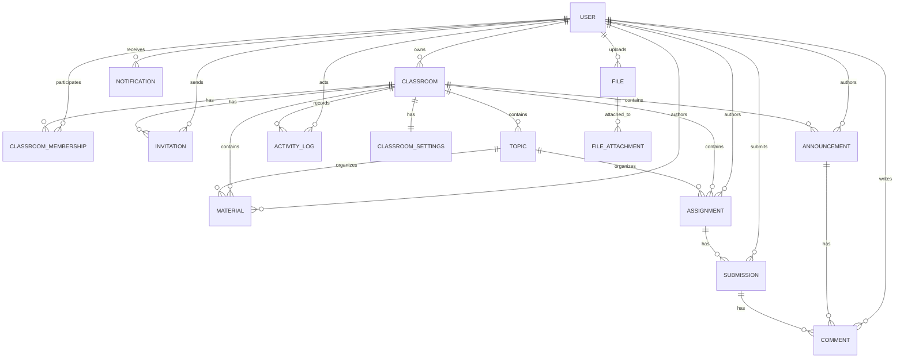

# Database Architecture

This document explains the Prisma PostgreSQL schema for GCR so a new developer can understand the data model, relationships, and operational conventions without reading every model definition line by line.

## 1. Architectural overview

The database is organized around a classroom-centric domain model:

- A user can own classrooms, join classrooms, receive notifications, and submit assignments.
- A classroom contains content such as topics, announcements, materials, assignments, and memberships.
- Classroom activity is tracked through submissions, comments, attachments, and audit-style activity logs.
- The schema favors explicit relationships, normalized storage, and predictable access patterns for a future UI and API layer.

The design uses soft-delete fields such as `deletedAt` on most content models so records can be hidden without being physically removed immediately.

## 2. Entity overview

| Entity              | Purpose                                                   | Key idea                                                    |
| ------------------- | --------------------------------------------------------- | ----------------------------------------------------------- |
| User                | Represents an administrator, teacher, or student account. | Central identity and role holder.                           |
| Classroom           | Represents a learning space.                              | Primary container for course content and participation.     |
| ClassroomSettings   | Stores classroom-specific configuration.                  | Keeps settings separate from the core classroom record.     |
| ClassroomMembership | Connects users to classrooms.                             | Canonical join table for participation and role assignment. |
| Invitation          | Tracks pending invites to join a classroom.               | Separates invite flow from membership state.                |
| Topic               | Organizes content within a classroom.                     | Provides structure for materials and assignments.           |
| Announcement        | Classroom-wide post or update.                            | Supports broadcast communication.                           |
| Material            | Shared resource such as a document or link.               | Stores classroom learning assets.                           |
| Assignment          | Task or activity posted to a classroom.                   | Main unit for student work.                                 |
| Submission          | Student response to an assignment.                        | Tracks work, status, and grading context.                   |
| Comment             | Discussion attached to an announcement or submission.     | Supports conversation and feedback.                         |
| Notification        | User-facing event generated from system activity.         | Supports in-app notifications.                              |
| File                | Metadata for a stored file.                               | Keeps database references to uploaded assets.               |
| FileAttachment      | Relates a file to a domain entity.                        | Allows reuse of a single file across multiple entities.     |
| ActivityLog         | Records system or user actions.                           | Provides a lightweight audit trail.                         |

## 3. Relationship explanation

### Core identity and access

- A User can own many Classrooms through the `ClassroomOwner` relation.
- A User can belong to many Classrooms through `ClassroomMembership`.
- A User can receive many Notifications and generate many ActivityLog entries.
- A User can also be invited to classrooms through Invitation records.

### Classroom content

- Each Classroom has zero or one `ClassroomSettings` row.
- Each Classroom can contain many Topics, Announcements, Materials, Assignments, Memberships, and Invitations.
- Topics are optional containers for Materials and Assignments, which helps keep classroom content organized.

### Interaction and feedback

- Announcements can have many Comments.
- Assignments can have many Submissions.
- Submissions can have many Comments.
- Comments are intentionally flexible because they can belong either to an announcement or a submission.

### File storage

- Files are stored as metadata rows, while the actual binary content is intended for external storage.
- FileAttachment links files to an entity such as an announcement, material, assignment, or submission.

### Audit and analytics

- ActivityLog captures actions such as creation, updates, joins, invites, submissions, and returns.
- It is intentionally lightweight and avoids coupling every workflow directly to a dedicated event table.

## 4. Enum explanation

The schema uses enums to keep states explicit and consistent.

### User roles

- `ADMIN`: platform-level administrator.
- `TEACHER`: educator or instructor.
- `STUDENT`: learner participant.

### Membership roles

- `OWNER`: classroom owner.
- `TEACHER`: teacher in a classroom.
- `CO_TEACHER`: secondary instructor.
- `STUDENT`: standard participant.
- `ASSISTANT`: support role for classroom operations.

### Membership status

- `PENDING`: invite accepted but not fully active yet.
- `ACTIVE`: current participant.
- `REMOVED`: removed from the classroom.
- `ARCHIVED`: no longer active but preserved for history.

### Classroom state

- `ACTIVE`: currently in use.
- `ARCHIVED`: available but no longer active.
- `DELETED`: marked deleted.

### Invitation state

- `PENDING`: waiting for response.
- `ACCEPTED`: invitation accepted.
- `EXPIRED`: invite expired.
- `REVOKED`: invite cancelled.

### Invitation type

- `EMAIL`: invite sent by email.
- `LINK`: invite via direct link.
- `CODE`: invite via access code.

### Announcement state

- `DRAFT`: not yet published.
- `PUBLISHED`: visible to classroom participants.

### Material type

- `DOCUMENT`, `LINK`, `VIDEO`, `IMAGE`, `OTHER`.

### Assignment state

- `DRAFT`: not yet published.
- `PUBLISHED`: available to students.
- `CLOSED`: no longer accepting submissions.

### Submission state

- `ASSIGNED`: work is expected but no submission yet.
- `SUBMITTED`: submitted for review.
- `LATE`: submitted after a deadline.
- `REVIEWED`: reviewed by the instructor.
- `RETURNED`: returned to the student.
- `MISSING`: expected but absent.

### Comment visibility

- `PUBLIC`: visible to classroom participants.
- `PRIVATE`: restricted to the author and teacher-side audiences.

### Notification type

- `NEW_ASSIGNMENT`, `NEW_MATERIAL`, `NEW_ANNOUNCEMENT`, `SUBMISSION_RETURNED`, `PRIVATE_COMMENT`, `GENERAL`.

### File attachment type

- `ANNOUNCEMENT`, `MATERIAL`, `ASSIGNMENT`, `SUBMISSION`.

### Activity action

- `CREATED`, `UPDATED`, `DELETED`, `ARCHIVED`, `JOINED`, `INVITED`, `SUBMITTED`, `RETURNED`.

## 5. Cascade rule explanation

The cascade rules control what happens when a parent record is removed.

| Parent       | Child               | Rule    | Why it exists                                                  |
| ------------ | ------------------- | ------- | -------------------------------------------------------------- |
| Classroom    | ClassroomSettings   | Cascade | Settings should disappear when the classroom is deleted.       |
| Classroom    | ClassroomMembership | Cascade | Memberships are only meaningful inside a classroom.            |
| Classroom    | Invitation          | Cascade | Invitations should be removed with the classroom.              |
| Classroom    | Topic               | Cascade | Topics are part of the classroom lifecycle.                    |
| Classroom    | Announcement        | Cascade | Announcements belong to a classroom.                           |
| Classroom    | Material            | Cascade | Materials are classroom-scoped.                                |
| Classroom    | Assignment          | Cascade | Assignments are classroom-scoped.                              |
| Classroom    | ActivityLog         | SetNull | Activity history can survive even if the classroom is removed. |
| Topic        | Material            | SetNull | Materials can remain loosely organized if a topic is removed.  |
| Topic        | Assignment          | SetNull | Assignments can survive without a topic.                       |
| Assignment   | Submission          | Cascade | Submissions are part of the assignment lifecycle.              |
| Announcement | Comment             | Cascade | Comments should disappear with the announcement.               |
| Submission   | Comment             | Cascade | Submission comments belong to that submission.                 |
| File         | FileAttachment      | Cascade | Attachments should disappear when the stored file is removed.  |
| User         | Notification        | Cascade | Notifications are tied to the recipient user.                  |

### Restrict rules

The schema also uses `Restrict` on several user-facing relationships to prevent accidental data loss:

- Deleting a User does not automatically delete owned classrooms or authored content.
- This protects the integrity of core records and forces a more deliberate cleanup flow.

## 6. Index explanation

Indexes support common read patterns such as filtering by owner, status, and timeline.

| Index                                              | Purpose                                                            |
| -------------------------------------------------- | ------------------------------------------------------------------ |
| Classroom owner and status indexes                 | Speed up classroom listing and filtering by owner or active state. |
| Membership by user and classroom+status            | Supports dashboard and join queries.                               |
| Invitation lookup by classroom and email           | Improves invite validation and lookup.                             |
| Topic ordering by classroom and position           | Ensures topic ordering remains efficient.                          |
| Announcement and material timelines                | Supports recent-content views.                                     |
| Assignment deadlines and author/topic lookups      | Helps with assignment dashboards and planning.                     |
| Submission lookup by student and assignment status | Supports grading and submission tracking.                          |
| Comment lookup by announcement and submission      | Speeds up discussion views.                                        |
| Notification lookup by recipient and read status   | Supports inbox and unread counts.                                  |
| File and attachment lookup by uploader and entity  | Supports media browsing and attachment resolution.                 |
| ActivityLog lookup by actor, classroom, and entity | Supports audit views and analytics.                                |

## 7. Composite constraint explanation

The schema uses composite constraints to enforce domain rules at the database level.

### Unique constraints

- `ClassroomMembership`: one user can only have one membership record per classroom.
- `Submission`: one submission record per assignment per student.
- `File`: one storage path per uploaded file.
- `FileAttachment`: one file can only be attached once to the same entity with the same attachment type.
- `ClassroomSettings`: one settings row per classroom because the relationship is one-to-one.

### Compound indexes

- `ClassroomMembership` uses a compound index on `(classroomId, status)` for classroom-based filtering.
- `Invitation` uses compound indexes for classroom-level invite queries and email-based lookups.
- `Submission` uses `(assignmentId, status)` to support status-based grading views.
- `Comment` uses compound indexes for announcement and submission comment timelines.
- `Notification` uses `(recipientId, isRead, createdAt)` to support inbox and unread ordering efficiently.

## 8. ER diagram

## 9. Practical guidance for developers

When adding new features, follow these conventions:

- Prefer using existing core entities before creating new tables.
- Keep relationship ownership explicit and use Prisma relation names where needed.
- Consider whether a new feature should be a child of Classroom, Assignment, Submission, or User.
- Preserve auditability by adding entries to ActivityLog when a meaningful domain action happens.
- Use the existing soft-delete pattern for content that should be hidden instead of removed instantly.
